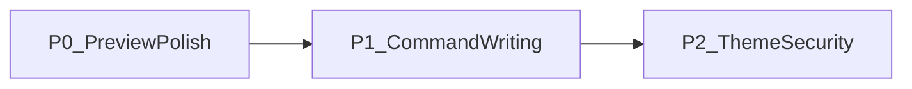

# 改进计划：能力完善与体验增强

> 在保持「本地优先 · 沉浸写作 · 无中间工具栏」初衷下，补齐预览与写作侧常见能力。  
> 最近写入：**2026-10-31**。进度总览见 [ROADMAP.md](./ROADMAP.md) · [PROGRESS.md](./PROGRESS.md)。

## 定位边界（保持初衷）

| 我们坚持 | 我们不做成 |
|---|---|
| 本地优先桌面写作应用（Tauri） | 可嵌入的 Markdown **组件库** / npm 分发产品 |
| 沉浸写作；菜单 + 状态栏；**无中间工具栏** | 以中间大工具栏为主交互 |
| 标准 Markdown 落盘；不强制云 | 为扩展能力牺牲源码可读性或默认放开不安全 HTML |

**原则：** 补「可组合 Markdown 能力 + 预览细节 + 可控扩展」；同等能力优先用 **菜单 / 命令面板 / 右键 / 浮动条** 呈现。

## 已具备（本轮重点是增强，而非补齐空白）

| 能力 | 现状 | 本轮方向 |
|---|---|---|
| 编辑引擎 | CM6 + Milkdown Crepe | 保持 |
| KaTeX / Mermaid | ✅ | 可按需懒加载（见 I13） |
| 代码高亮 | Shiki | 叠加行号 / 指定行高亮 / 复制 |
| XSS / 净化 | DOMPurify + `html: false` | 补扩展白名单策略说明 |
| 滚动联动 | ✅ | 保持 |
| TOC | ✅ 侧栏大纲 | 增强预览联动与当前节高亮 |
| 本地图 / 图床 | `./assets/` + PicGo 等多配置 | 统一插入契约 |
| 主题 | 内置 + 自定义 CSS | 主题包可声明预览能力 |
| i18n | 五语壳层 | 扩语言优先级低于写作能力 |

**明确不做：** 中间工具栏主 UI；对外发布「编辑器组件库」；为省事引入不安全 HTML 默认通道。

## 待办清单（按优先级）

状态：`☐` 未做 · `🔄` 进行中 · `✅` 完成 · `⏸` 暂缓

### P0 — 高价值、低违和

| # | 项 | 状态 | 交互约束 | 备注 |
|---|---|---|---|---|
| I1 | 预览 TOC 增强（层级 / 当前节高亮 / 跳转） | ✅ | 侧栏或预览附属，不加中间栏 | 2026-10-31：双栏预览滚动 → 大纲当前节高亮 |
| I2 | 代码块一键复制 | ✅ | 仅预览态悬浮按钮 | 2026-10-31：`enhance.ts` + `PreviewPane`；导出剥离 |
| I3 | 代码块行号 | ✅ | 预览可选开关（prefs，默认关） | 2026-10-31：视图菜单；Shiki transformer |
| I4 | 高亮指定行（如 `{1,3-5}`） | ✅ | 与 Shiki 管线结合 | 2026-10-31：`ts{1,3-5}` / `ts {1,3-5}` |
| I5 | Tip / warning / danger / details 容器 | ✅ | 扩展语法；右键「插入」；无中间栏 | 2026-11-01：tip/info/warning/danger/details |
| I6 | 图片点击预览（灯箱） | ✅ | 预览态 | 2026-10-31：点击放大；Esc / 点遮罩关闭 |

### P1 — 增强写作，不加工具栏

| # | 项 | 状态 | 交互约束 | 备注 |
|---|---|---|---|---|
| I7 | 命令面板补齐格式化动作 | ✅ | 命令面板 / 菜单 / 快捷键 | 2026-11-01：Ctrl+Shift+P；格式/插入/视图/导航 |
| I8 | 统一「插入图片」契约 | ✅ | 粘贴 / 拖拽 / 菜单同一路径 | 2026-11-01：`resolveImages` + 选文件插入 |
| I9 | 图片尺寸语法（attrs） | ✅ | 源码可写、预览可渲染 | 2026-11-01：`=400x` / `{width=400}` |
| I10 | 全屏 / 沉浸模式族整理 | ✅ | 与 Focus / 打字机并列 | 2026-11-01：F11 全屏；三层正交；Esc 阶梯 |

### P2 — 主题、安全与工程

| # | 项 | 状态 | 交互约束 | 备注 |
|---|---|---|---|---|
| I11 | 主题包约定（CSS + 可选预览能力开关） | ✅ | 文档 + 示例主题 | 2026-11-01：`lunark-features` + THEME_PACK.md |
| I12 | 净化 / XSS 扩展策略说明 | ✅ | 文档为主；必要时 API | 2026-11-01：SECURITY-XSS + `sanitize.ts` |
| I13 | KaTeX / Mermaid 等重依赖按需加载 | ✅ | 首次使用再加载 | 2026-11-01：mermaid/katexLazy 动态 import |
| I14 | 用户文档：扩展语法与示例 | ✅ | 帮助 / welcome / docs | 2026-11-01：帮助面板 + SYNTAX.md |

### P3 — 按需再做

| # | 项 | 状态 | 备注 |
|---|---|---|---|
| I15 | Emoji 插入 | ✅ | 2026-11-01：命令面板精简词表 |
| I16 | 对齐容器（align-left/center/right） | ✅ | 2026-11-01：`::: align-*` + 预览样式 |
| I17 | 更多界面语言 | ⏸ | 五语已覆盖；扩语种需完整 MessageSchema 翻译 |
| I18 | 自定义锚点进阶 | ✅ | 2026-11-01：`{#id}` ↔ TOC / 预览 |

## 建议落地顺序

1. **先做 P0**：预览侧小交互与可选语法，不碰主布局哲学。  
2. **再做 P1**：用命令面板把常见格式化能力换皮进来。  
3. **P2 与社区主题 / 内测反馈并行**：约定写清楚再扩能力。  
4. **P3 仅在有明确用户反馈时打开。**

## 近期排期（P0 内细排）

> 依据：可复用现有代码、用户可见收益、不碰布局哲学、依赖关系。核对：**2026-10-31**。

| 次序 | 项 | 为何这时做 | 首刀落点（建议） |
|---|---|---|---|
| ✅ | I2 代码块一键复制 | 已落地 | `enhance.ts` + `PreviewPane`；印刷/Word 导出剥离 |
| ✅ | I1 大纲当前节高亮 | 已落地 | 预览滚动解析当前节 → `activeHeadingId` → 侧栏高亮 |
| ✅ | I3 代码行号 | 已落地 | 视图菜单 prefs；默认关 |
| ✅ | I4 高亮指定行 | 已落地 | fence `{1,3-5}` → Shiki `.highlighted` |
| ✅ | I6 图片灯箱 | 已落地 | 预览点击放大；Esc / 遮罩关闭 |
| ✅ | I5 tip 等容器 | 已落地 | 右键插入；预览渲染；非标准 MD 扩展 |
| ✅ | I7 命令面板 | 已落地 | Ctrl+Shift+P；格式/插入/视图/导航 |
| ✅ | I8 统一插图 | 已落地 | `resolveImages` + 选文件插入 |
| ✅ | I9 图片尺寸 | 已落地 | `=400x300` / `{width=400}`；预览尊重尺寸 |
| ✅ | I10 沉浸模式族 | 已落地 | 全屏 / Focus / 打字机正交；Esc 阶梯 |
| ✅ | I11 主题包约定 | 已落地 | `lunark-features`；`themes/THEME_PACK.md`；preview-kit |
| ✅ | I12 净化 / XSS | 已落地 | [SECURITY-XSS.md](./SECURITY-XSS.md)；`sanitizePreviewHtml` |
| ✅ | I13 重依赖按需 | 已落地 | Mermaid / KaTeX 动态 import；CSS 首遇公式再注 |
| ✅ | I14 扩展语法文档 | 已落地 | 帮助面板；welcome；[SYNTAX.md](./SYNTAX.md) |

| ✅ | I15 Emoji | 已落地 | 命令面板插入 |
| ✅ | I16 对齐容器 | 已落地 | `::: align-*` |
| ✅ | I18 自定义锚点 | 已落地 | `## 标题 {#id}` |

**P0–P2 与 P3（I15/I16/I18）已完成。** I17（更多界面语言）仍暂缓。

## 验收红线

- 不恢复**中间主工具栏**作为默认写作 UI。  
- 扩展语法须能**标准 Markdown 源码落盘**（或明确标注为可选方言并文档化）。  
- 新渲染能力默认走现有 **DOMPurify** 管线；禁止为省事放开不安全 HTML。  
- 不把产品改造成可发布的「编辑器 npm 组件库」；内部模块化即可。

## 相关文档

- 初衷：[PRD.md](./PRD.md)  
- 四期定位：[PHASE4.md](./PHASE4.md)  
- 扩展语法：[SYNTAX.md](./SYNTAX.md)  
- 净化 / XSS：[SECURITY-XSS.md](./SECURITY-XSS.md)  
- 主题包：[themes/THEME_PACK.md](../themes/THEME_PACK.md)  
- 路线图 / 进度：[ROADMAP.md](./ROADMAP.md) · [PROGRESS.md](./PROGRESS.md)
