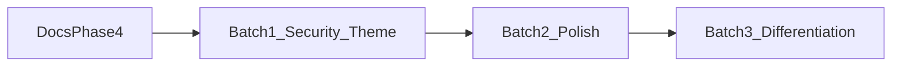

# 四期：安全基线与主题生态

> 一期～三期见 [ROADMAP.md](./ROADMAP.md) · [PROGRESS.md](./PROGRESS.md)。  
> **桌面批次（含余量）已落地**（2026-10-17）。移动端壳 **预留、暂不排期**（后续跨平台扩展）。

定位：一期双栏 → 二期混合编辑 → 三期会话与搜索 → **四期：收紧权限、接入社区主题、再打口碑与差异化**。

## 原则

1. **安全白名单先于新功能。** Tauri 的优势是能力范围可控；全盘放行会把这个优势抵消。
2. **接入现成主题，不在仓库里再手写一套同名皮肤。** 内置五套主题保持现状；新工作是让外部 CSS 能作用到预览 DOM。
3. **差异化排在口碑项之后。** 本地助手、版本历史、双向链接等不进第一批（现已在第三批落地）。
4. **继续预留，不在四期近期打开：** 移动端壳、Vim、代码签名与公证。

## 落地后现状（对照代码，2026-10-17）

| 项 | 现状 | 位置 |
|---|---|---|
| 文件范围 | 默认 `$HOME` 等用户目录；运行时 `grant_user_path` | `capabilities/default.json`、`scope_grant.rs` |
| 资源协议 | 与 fs 同策略收敛 | `tauri.conf.json` `assetProtocol.scope` |
| CSP | 生产无 `unsafe-eval`；dev 用 `tauri.dev.conf.json` 保留 HMR | 同上 |
| 自定义主题 | 导入 + 消毒；预览 `#write` / 内容类名 | `customCss.ts`、`previewThemeClasses.ts` |
| 发布体积 | Release Step Summary；NSIS >15MB warning | `.github/workflows/release.yml` |
| 窗口几何 | 启动前 Rust + JS 恢复上次尺寸；壳层就绪后再 `show` | `window_geom.rs`、`bootstrapGeometry.ts` |

## 批次

### 第一批 — **已落地**

| # | 项 | 状态 | 关键改动 |
|---|---|---|---|
| S1 | 文件系统范围 | ✅ | 能力 / 资源协议默认 `$HOME` 与常见用户目录；`grant_user_path` 运行时放行对话框与会话路径（`src-tauri/src/scope_grant.rs`、`src/lib/fs/scope.ts`） |
| S2 | CSP | ✅ | 生产去掉 `unsafe-eval`；`pnpm tauri:dev` 仍用 `src-tauri/tauri.dev.conf.json` 保留 Vite HMR 所需的 `unsafe-eval` |
| F1 | 预览主题兼容 | ✅ | 预览根 `id="write"`；围栏 / 任务 / 图片 / 脚注补内容类名；壳层选择器仅 `console.info`；示例 `themes/examples/content-hooks.css` |
| S3 | 发布体积 | ✅ | Release 记入 Step Summary；Windows NSIS 超过 15MB 发 **warning**，不阻断 |

F1 只覆盖预览 DOM。源码模式与混合编辑的节点类名不在第一批。

### 第二批 — **已落地**

| # | 项 | 状态 | 关键改动 |
|---|---|---|---|
| E3 | 表格 | ✅ | 删行；粘贴 TSV / HTML table → GFM（`tablePaste.ts`）；工具条已有增删列与对齐 |
| F3 | 图床 | ✅ | PicGo/自定义 URL 多配置（`ImageHostDialog`）；菜单开关；失败回退 `assets/`；Crepe 同路径 |
| F4 | 拼写 | ✅ | 源码模式英文词表波浪线；菜单「英文拼写检查」 |
| P4 | 预览缓存 | ✅ | `previewCache` 按块哈希复用 HTML |
| U3 | 窗口材质 / 标题栏 | ✅ | Win11 Mica / Acrylic；**自绘标题栏**（`decorations: false` + `TitleBar.vue`；菜单可关） |
| U4 | 启动窗口尺寸 | ✅ | `visible: false` → Rust/`bootstrapGeometry` 恢复 → hydrate 后再 `show`，避免小窗跳变 |

### 第三批 — **桌面项已落地 · 移动端预留**

| # | 项 | 状态 | 关键改动 |
|---|---|---|---|
| X1 | 本地 AI | ✅ | Ollama HTTP；右键「本地 AI」；视图开关 + **模型子菜单**（`/api/tags`） |
| F6 | 快照 | ✅ | 保存写入配置目录 `snapshots/`；**HistoryDialog** 任选恢复 |
| X2 | Wiki 链 | ✅ | `[[Page]]` 预览可点；侧栏「反链」 |
| X4 | Git 时间线 | ✅ | `git_file_log` / `git_show_file`（系统 git）；视图菜单打开时间线 |
| X3 | 移动端壳 | ⏸ 预留 | 仅有入口桩；**暂不排期**，留给后续跨平台扩展 |

### 相关桌面能力（二三期余量，同期落地）

| 项 | 状态 | 说明 |
|---|---|---|
| Crepe 切 Tab | ✅ | 按 Tab 缓存实例（LRU≤6）+ 首次延迟挂载 |
| 图床管理 UI | ✅ | 多配置；与粘贴/拖图/混合上传共用 |

## 与已有能力的关系

- 自定义主题导入、消毒、prefs 里的 `themeId` **保持**。F1 是在预览 HTML 上补类名，让已导入的 CSS 能命中内容区。
- 内置主题仍走 `[data-theme]` 变量，不改成外部样式表替换。
- 图床：默认本地 `assets/`；可选远程（PicGo Server 或兼容自定义 URL）。
- 本地 AI 需本机 `ollama serve`；默认模型 `llama3.2`；视图菜单可切换已拉取模型。
- Git 时间线依赖本机 `git` 且文件在仓库内；只读浏览，确认后载入到编辑器（不自动 commit）。

## 建议下一步

1. **手测**四期全量（含模型、快照/Git、图床对话框、自绘标题栏、启动尺寸无跳变）与 [QA-SMOKE](./QA-SMOKE.md)。
2. **内测分发**：CI / NSIS Release，收集反馈打磨。
3. **预留不动**：移动端壳、Vim、代码签名 / 公证。
