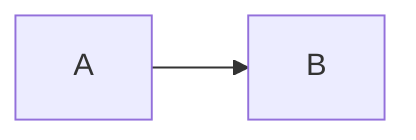

# 扩展语法速查

面向写作用户的语法说明。应用内：**帮助 → 扩展语法…**（与本文同步维护）。

标准 CommonMark / GFM 默认可用。下表中标 **方言** 的项为 Lunark 可选扩展，仍以可读 Markdown 源码落盘。

## 提示容器（方言）

右键「插入」或命令面板可插入。

````markdown
::: tip 标题
内容
:::

::: info
:::

::: warning
:::

::: danger
:::

::: details 折叠标题
隐藏内容
:::
````

## 图片尺寸（方言）

````markdown


{width=400}
{width=50%}
````

Typora 风 `=WxH` 会在预览前规范成 attrs。预览点击图片可灯箱放大。

## 代码行高亮（方言）

````markdown
```ts{1,3-5}
line1
line2
line3
```
````

预览「代码行号」在 **视图** 菜单开关（默认关），与主题包 `lunark-features: line-numbers` 无关 prefs。

## 公式（KaTeX）

````markdown
行内 $E=mc^2$

$$
\int_0^1 x^2\,dx
$$
````

## 图表（Mermaid）

````markdown

````

## 对齐容器（方言）

````markdown
::: align-center
居中内容
:::
````

`align-left` / `align-center` / `align-right`。命令面板或右键插入。

## 自定义标题锚点（方言）

````markdown
## 章节标题 {#custom-id}
````

大纲与预览跳转共用该 id；渲染时不显示 `{#…}` 标记。

## Wiki 链（方言）

````markdown
[[笔记名]]
[[笔记名|显示文本]]
````

工作区内按标题 / 文件名解析；侧栏可看反链。

## Emoji

命令面板搜索 `emoji` / 中英文关键词（如 `笑`、`fire`）插入常用表情。

## 任务列表与脚注（GFM）

````markdown
- [x] 已完成
- [ ] 待办

脚注[^1]

[^1]: 脚注正文
````

## 相关

- 主题包：[themes/THEME_PACK.md](../themes/THEME_PACK.md)  
- 净化策略：[SECURITY-XSS.md](./SECURITY-XSS.md)  
- 快捷键：应用内 **帮助 → 快捷键说明**（F1）  
